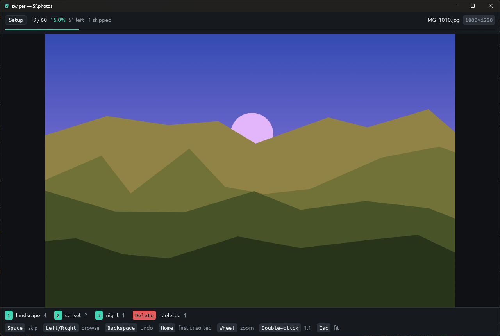
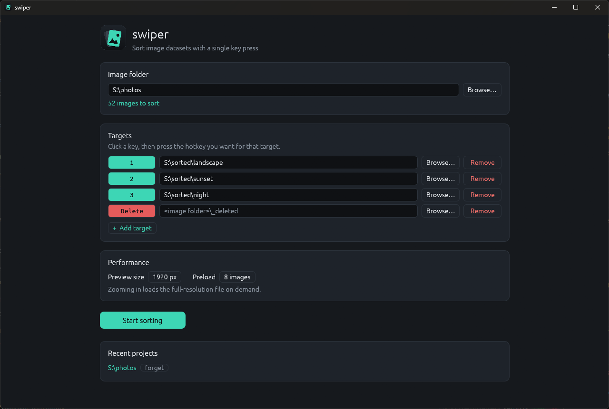

<p align="center">
  
</p>

<h1 align="center">swiper</h1>

<p align="center">
  A tiny, keyboard-driven image sorter for curating datasets.<br>
  One key press moves the image, and the next one is already on screen.
</p>

---

> [!NOTE]
> **This whole project was made by Claude, an AI model by Anthropic, as an experiment.**
>
> All of it came out of a conversation with [Claude Code](https://claude.com/claude-code): the Rust code, the logo, the colour palette and this README. The repository owner described what they wanted (a lightweight tool to sort thousands of images into folders with hotkeys) and gave feedback. Claude designed, wrote, built and tested it.
>
> It's a toy project for trying out AI-assisted development, not a maintained product. It has been tested on Windows 11 with a few hundred images, but it has no automated test suite and hasn't been reviewed by a human expert. It moves your files around, so **keep a backup of anything you care about.**

---

<p align="center">
  
  
</p>

## What it does

You point swiper at a folder of images and pick a few target folders, each with a hotkey (for example `1` = cat, `2` = dog, `Delete` = junk). It then shows the images one at a time. Press a target's key and the image moves to that folder, and the next image appears instantly.

It's built for folders of **1,000–50,000+ images**, and it aims to be as lightweight as possible.

## Features

- **No waiting between images.** The next 8 images are decoded, downscaled and uploaded to the GPU in the background on all spare CPU cores, so they're ready before you press the key.
- **Non-blocking file moves.** Files are moved on a separate thread, in order. The UI never waits for the disk.
- **Lightweight.** A single ~6 MB executable that uses no CPU when idle and around 100–150 MB of RAM while sorting (most of that is preloaded images, and you can turn it down).
- **Delete key built in.** `Delete` sends images to `<folder>\_deleted` by default. Nothing is ever permanently deleted, so it can always be undone.
- **Undo.** `Backspace` / `Ctrl+Z` puts the last image back. This works across sessions too.
- **Progress is saved automatically.** Every action is written to a log as it happens. Close the app any time and it picks up where you left off.
- **Skip and browse.** `Space` skips an image (it stays where it is and is remembered), and the arrow keys let you look back and forth.
- **Zoom for detail.** Use the mouse wheel to zoom, drag to pan, and double-click for 100% (1:1 pixels). When you zoom past the preview's resolution, the full-resolution file is loaded for the current image.
- **Setup screen.** Double-click the exe to choose a folder, add and remove targets, assign hotkeys by pressing them, and reopen recent projects.
- **Safe moves.** Existing files are never overwritten. A name clash becomes `name_1.jpg`. Moves across drives fall back to copy-and-delete.
- **Correct rotation and order.** Photos are shown upright using their EXIF orientation, and files are sorted naturally (`img2` comes before `img10`).
- **Dark theme only.** A calm dark palette with a teal accent. Delete is shown in red so it never looks like a class.

Supported formats: JPEG, PNG, WebP, BMP, GIF (first frame) and TIFF.

## Getting started

### Build from source

You need a recent stable Rust toolchain (edition 2024, so Rust 1.85 or newer).

```bash
git clone <this repo>
cd swiper
cargo build --release
```

The executable is at `target/release/swiper.exe` (or `target/release/swiper` on Linux/macOS).

### Run it

**Double-click** `swiper.exe` (or run it with no arguments) to open the setup screen:

1. Choose the **image folder**.
2. Add **targets**: click a key button, press the hotkey you want, and pick the destination folder.
3. Press **Start sorting**.

**From a terminal**, you can skip the setup screen:

```bash
swiper D:\data\raw 1=D:\data\cat 2=D:\data\dog 3=D:\data\other
```

Targets are remembered per folder, so next time this is enough:

```bash
swiper D:\data\raw
```

All command-line options:

```text
swiper [<image-folder> [KEY=DEST ...]] [--max-side N] [--ahead N]

  KEY=DEST      bind a key to a destination folder, e.g. 1=D:/data/cat  a=sorted/dog
                KEY is a single letter/digit or a key name (F1, Delete, Enter, ...)
  --max-side N  downscale images for display to at most N px (default 1920)
  --ahead N     number of images to preload ahead (default 8)
```

## Controls

| Input | Action |
|---|---|
| your target keys | move the image to that target and show the next one |
| `Delete` | move the image to `<image folder>\_deleted` (default target, can be changed) |
| `Space` | skip: leave the image in place and show the next one |
| `←` / `→` | browse the previous / next image |
| `Backspace` / `Ctrl+Z` | undo the last move |
| `Home` | jump to the first unsorted image |
| mouse wheel / pinch | zoom around the cursor |
| drag | pan while zoomed |
| double-click | toggle between fit-to-window and 100% |
| `Esc` | back to fit-to-window |
| **Setup** button | go back to the setup screen (pending moves finish first) |

`←`, `→`, `Space`, `Backspace`, `Home` and `Esc` are reserved for navigation and can't be used as target keys.

## How it works

```
             ┌──────────────────────── UI thread (egui) ───────────────────────┐
 keypress ─► │ mark image as moved → advance cursor → draw preloaded texture   │
             └───────┬──────────────────────────────────────────▲──────────────┘
                     │ Move/Undo/Skip ops (ordered)             │ decoded RGBA
                     ▼                                          │
          ┌─────────────────────┐                   ┌───────────┴───────────┐
          │ file worker thread  │                   │ decoder pool          │
          │ rename / copy+del   │                   │ (CPU cores − 1)       │
          │ append to log.tsv   │                   │ decode → orient →     │
          └─────────────────────┘                   │ downscale             │
                                                    └───────────────────────┘
```

- The UI keeps a **window** of images around the cursor: the current one, 2 behind and N ahead. Anything outside the window is evicted from GPU memory, and queued decode jobs you've already skipped past are dropped.
- **Progress comes from the file system.** Files you've moved are simply no longer in the source folder. The log adds the rest: skipped files and where each moved file went (for undo).
- Only the top level of the image folder is scanned. Subfolders (including `_deleted` and `.swiper`) are ignored.

### Files swiper creates

| Path | Purpose |
|---|---|
| `<image folder>/.swiper/targets.txt` | the project's key → folder bindings |
| `<image folder>/.swiper/log.tsv` | append-only log: `M name dest` (moved), `S name` (skipped), `U name` (undone) |
| `<image folder>/_deleted/` | default destination for the `Delete` key |
| `%APPDATA%/swiper/recent.txt` | recent projects (`~/.config/swiper/` on other systems) |

Delete `.swiper/` to start a project from scratch. Empty `_deleted/` once you're happy with the result.

## Tuning

On the setup screen (under *Performance*) or on the command line:

- **Preview size** (`--max-side`): smaller previews mean less memory and faster decoding. Zooming still loads the full-resolution file on demand.
- **Preload** (`--ahead`): more images ahead absorbs bursts of very fast key presses, at the cost of memory.

For example, `--max-side 1280 --ahead 4` is a good low-memory setup.

## Project layout

```
src/
  main.rs     entry point, command-line parsing, switching between screens
  setup.rs    setup screen (folder, targets, hotkeys, recent projects)
  sorter.rs   sorting screen: preloading, decoder pool, file worker, zoom
  config.rs   targets, per-project persistence, recent projects
  files.rs    listing, natural sort, action log, safe moves
  theme.rs    dark colour palette and small shared widgets
assets/       logo, Windows icon and screenshots
build.rs      embeds the icon into the Windows executable
```

Built with [egui/eframe](https://github.com/emilk/egui) (glow backend), [image](https://github.com/image-rs/image), [rfd](https://github.com/PolyMeilex/rfd) for the native folder picker, and [winresource](https://github.com/BenjaminRi/winresource) for the exe icon.

## Known limitations

- Developed and tested on **Windows 11** only. The code is meant to be portable, but Linux and macOS are untested. On Linux, the folder picker needs one of `rfd`'s backend features (`xdg-portal` or `gtk3`) enabled in `Cargo.toml`.
- Images in subfolders aren't included, and only file-name order is supported.
- RAW, HEIC and AVIF files aren't supported. Animated GIFs show their first frame.
- No automated tests. It was checked by hand, by driving the real app.

## License

[MIT](LICENSE). Use it, change it, share it. It comes with no warranty, which seems especially fitting for an AI experiment.

---

<p align="center"><sub>Written by Claude (Anthropic) using Claude Code, as an experiment in AI-assisted development.</sub></p>
